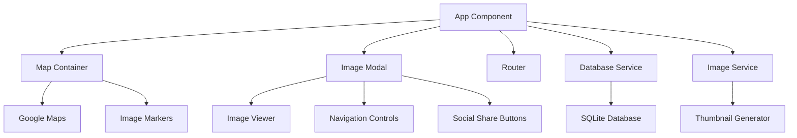

# Design Document

## Overview

The spyo-map is a React/TypeScript web application that displays geo-tagged images on an interactive Google Maps
interface. The system consists of two main components: a Python data preparation script and a React web application. The
Python script processes image folders to extract EXIF data into an SQLite database, while the React app provides an
interactive map interface for browsing and viewing images.

## Architecture

### High-Level Architecture


### Component Architecture



## Components and Interfaces

### 1. Python EXIF Extractor (`extract_exif.py`)

**Purpose:** Processes image folders to extract EXIF metadata and generate SQLite database

**Key Functions:**
- `scan_images(folder_path: str) -> List[ImageData]`
- `extract_exif(image_path: str) -> Dict[str, Any]`
- `create_database(images: List[ImageData], db_path: str) -> None`
- `generate_thumbnails(image_path: str, thumbnail_dir: str) -> str`

**Dependencies:**
- `Pillow` for image processing and EXIF extraction
- `sqlite3` for database operations
- `os` and `pathlib` for file system operations

### 2. Database Service (`src/services/DatabaseService.ts`)

**Purpose:** Handles SQLite database queries and data transformation

```typescript
interface ImageRecord {
  id: string;
  path: string;
  thumbnailPath: string;
  latitude: number;
  longitude: number;
  timestamp: string;
  latitudeRef?: string; // e.g.: North latitude
  longitudeRef?: string; // e.g.: East longitude
  altitudeRef?: string; // e.g.: Sea level
  altitude?: number;
  speedRef?: string; // e.g.: Kilometers per hour
  speed?: number;
  imgDirectionRef?: string; // e.g.: Magnetic direction
  imgDirection?: number;
  destBearingRef?: string; // e.g.: Magnetic direction
  destBearing?: number;
  hPositioningError?: number;
}

class DatabaseService {
  async loadImages(): Promise<ImageRecord[]>
  async getImageById(id: string): Promise<ImageRecord | null>
  async getNearbyImages(lat: number, lng: number, radiusKm: number): Promise<ImageRecord[]>
}
```

### 3. Map Container Component (`src/components/MapContainer.tsx`)

**Purpose:** Manages Google Maps integration and image marker display

```typescript
interface MapContainerProps {
  images: ImageRecord[];
  selectedImageId?: string;
  onImageSelect: (imageId: string) => void;
}

const MapContainer: React.FC<MapContainerProps>
```

**Key Features:**
- Google Maps integration using `@googlemaps/react-wrapper`
- Custom image markers with thumbnail previews
- Marker clustering for dense areas
- Map controls and zoom functionality

### 4. Image Modal Component (`src/components/ImageModal.tsx`)

**Purpose:** Displays full-size images with navigation and sharing controls

```typescript
interface ImageModalProps {
  image: ImageRecord | null;
  nearbyImages: ImageRecord[];
  isOpen: boolean;
  onClose: () => void;
  onNavigate: (direction: 'prev' | 'next') => void;
}

const ImageModal: React.FC<ImageModalProps>
```

**Key Features:**
- Full-screen image display with responsive sizing
- Keyboard navigation (arrow keys, escape)
- Touch/swipe support for mobile
- Social sharing integration

### 5. Social Share Component (`src/components/SocialShare.tsx`)

**Purpose:** Provides social media sharing functionality

```typescript
interface SocialShareProps {
  imageUrl: string;
  imageTitle?: string;
}

const SocialShare: React.FC<SocialShareProps>
```

**Supported Platforms:**
- Twitter/X with image URL and optional text
- Facebook with Open Graph metadata
- Instagram (copy link functionality)

### 6. Router Configuration (`src/router/AppRouter.tsx`)

**Purpose:** Handles client-side routing for image URLs

```typescript
// Route structure:
// / - Main map view
// /image/:imageId - Direct image access
// /location/:lat/:lng - Location-based view
```

## Data Models

### Image Database Schema

```sql
CREATE TABLE images (
    id TEXT PRIMARY KEY,
    latitude REAL
    longitude REAL
    timestamp TEXT
    latitude_ref TEXT
    longitude_ref TEXT
    altitude_ref INTEGER
    altitude REAL
    speed_ref TEXT
    speed REAL
    img_direction_ref TEXT
    img_direction REAL
    dest_bearing_ref TEXT
    dest_bearing REAL
    h_positioning_error REAL
);

CREATE INDEX idx_location ON images(latitude, longitude);
CREATE INDEX idx_timestamp ON images(timestamp);
```

### TypeScript Interfaces

```typescript
interface GeoLocation {
  latitude: number;
  longitude: number;
}


interface ImageRecord {
  id: string;
  path: string;
  thumbnailPath: string;
  location: GeoLocation;
  timestamp?: string;
}

interface AppState {
  images: ImageRecord[];
  selectedImage: ImageRecord | null;
  mapCenter: GeoLocation;
  mapZoom: number;
  isModalOpen: boolean;
}
```

## Error Handling

### Python Script Error Handling
- **Invalid image files:** Skip and log warning
- **Missing EXIF data:** Skip image processing
- **Database errors:** Rollback transaction and report error
- **File system errors:** Graceful handling with user feedback

### React Application Error Handling
- **Database loading errors:** Display error message with retry option
- **Google Maps API errors:** Fallback to basic map or error state
- **Image loading errors:** Show placeholder with error indication
- **Network errors:** Implement retry logic with exponential backoff

### Error Boundaries
```typescript
class ImageErrorBoundary extends React.Component {
  // Catches errors in image loading and display
}

class MapErrorBoundary extends React.Component {
  // Catches errors in map rendering
}
```

## Testing Strategy

### Unit Testing
- **Database Service:** Mock SQLite operations, test data transformation
- **Utility Functions:** Test distance calculations, EXIF parsing
- **Components:** Test rendering, user interactions, state management
- **Routing:** Test URL generation and navigation

### Integration Testing
- **Map Integration:** Test Google Maps API integration
- **Database Integration:** Test SQLite database queries
- **Image Loading:** Test image and thumbnail loading
- **Social Sharing:** Test share URL generation

### End-to-End Testing
- **User Workflows:** Test complete user journeys
- **Mobile Responsiveness:** Test touch interactions and responsive design
- **Performance:** Test loading times and memory usage
- **Cross-browser:** Test compatibility across browsers

### Testing Tools
- **Jest** for unit testing
- **React Testing Library** for component testing
- **Cypress** for end-to-end testing
- **Lighthouse** for performance testing

## Performance Considerations

### Image Optimization
- **Thumbnail Generation:** Create optimized thumbnails during data preparation
- **Lazy Loading:** Load images only when needed
- **Progressive Loading:** Show low-quality placeholders first
- **Caching:** Implement browser caching for images and thumbnails

### Database Optimization
- **Indexing:** Create indexes on location and timestamp columns
- **Query Optimization:** Use spatial queries for nearby image searches
- **Data Compression:** Compress EXIF JSON data
- **Connection Pooling:** Reuse database connections

### Bundle Optimization
- **Code Splitting:** Split code by routes and features
- **Tree Shaking:** Remove unused code
- **Minification:** Compress JavaScript and CSS
- **Compression:** Enable gzip/brotli compression

### Map Performance
- **Marker Clustering:** Group nearby markers to reduce rendering load
- **Viewport Culling:** Only render markers in visible area
- **Debounced Updates:** Throttle map updates during pan/zoom
- **Memory Management:** Clean up map resources properly

## Security Considerations

### Data Privacy
- **EXIF Sanitization:** Remove sensitive EXIF data before display
- **Location Privacy:** Option to blur exact coordinates
- **User Data:** No personal data collection or storage

### Web Security
- **Content Security Policy:** Implement CSP headers
- **HTTPS Only:** Enforce secure connections
- **Input Validation:** Validate all user inputs
- **XSS Prevention:** Sanitize any user-generated content

### API Security
- **Google Maps API:** Restrict API key to specific domains
- **Rate Limiting:** Implement client-side rate limiting
- **Error Handling:** Don't expose sensitive error information

## Deployment Architecture

### Static Hosting Structure
```
/
├── index.html
├── static/
│   ├── js/
│   ├── css/
│   └── media/
├── images/
│   ├── full/
│   └── thumbnails/
├── images.db (SQLite database)
└── manifest.json
```

### Build Process
1. **Development:** Vite dev server with hot reload
2. **Production Build:** Vite build with optimization
3. **Asset Processing:** Generate thumbnails and optimize images
4. **Database Generation:** Run Python script to create SQLite database
5. **Deployment:** Upload static files to web host

### Environment Configuration
- **Development:** Local development with mock data
- **Production:** Optimized build with real image database
- **Environment Variables:** Google Maps API key configuration