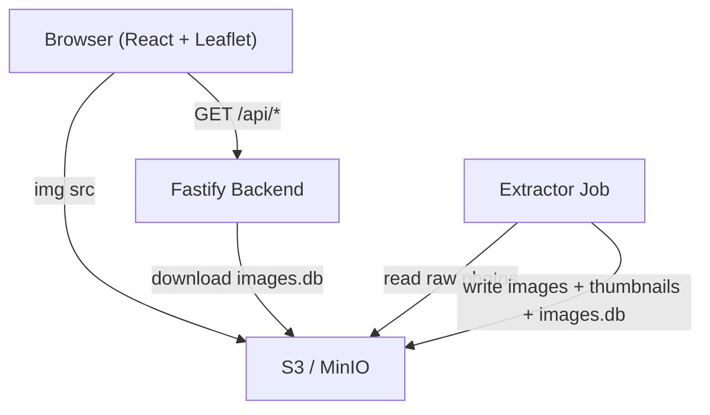
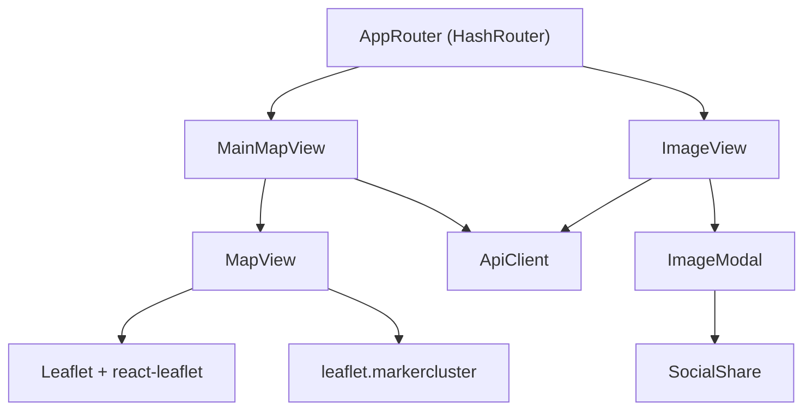

# Design Document

## Overview

Spyro Map is a web application that displays geo-tagged images on an interactive map. Users can
browse photos by location, view them in a modal lightbox, navigate between nearby images, and share
on social media.

The system consists of four cooperating components: a React + Leaflet frontend (static hosting),
a Fastify REST API backend (Docker/ECS), an S3/MinIO object store (images + metadata), and a
TypeScript extractor job that processes raw photos.

## Architecture

### High-Level Architecture

```
Browser (React + Leaflet)
  │
  ├─ GET /api/*  ──────────▶  Fastify backend (Docker/ECS)
  │                               │
  │                               ├─ downloads images.db from S3/MinIO at startup
  │                               └─ refreshes every ~5 min (or on POST /api/reload)
  │
  └─   ──────▶  S3/MinIO (direct, no backend proxy)
                                  ├── raw/              ← drop source photos here
                                  ├── images/           ← processed full-size (public read)
                                  │   └── thumbnails/   ← thumbnails (public read)
                                  └── images.db         ← written by extractor job
```



### Component Architecture



### Monorepo Layout

```
packages/
├── shared/      # Shared TypeScript types (ImageRecord, GeoLocation, etc.)
├── frontend/    # React + Vite + Leaflet SPA
├── backend/     # Fastify REST API server
└── extractor/   # Image ingestion job (TypeScript, runs as Docker container)
```

## Components and Interfaces

### 1. Shared Types (`packages/shared/src/types.ts`)

```typescript
interface GeoLocation {
  latitude: number;
  longitude: number;
}

interface ImageRecord {
  id: string;
  imageUrl: string;       // absolute URL — served directly from S3/MinIO
  thumbnailUrl: string;   // absolute URL — served directly from S3/MinIO
  latitude: number;
  longitude: number;
  timestamp: string;
  latitudeRef?: string;
  longitudeRef?: string;
  altitudeRef?: string;
  altitude?: number;
  speedRef?: string;
  speed?: number;
  imgDirectionRef?: string;
  imgDirection?: number;
  destBearingRef?: string;
  destBearing?: number;
  hPositioningError?: number;
}
```

`imageUrl` and `thumbnailUrl` are absolute URLs pointing directly at S3/MinIO. The frontend never
derives image paths from IDs — it uses whatever URLs the API returns.

### 2. Backend (`packages/backend/`)

**Purpose:** Reads `images.db` and serves image metadata via REST API. Never proxies image bytes.

#### Database service (`src/services/database.ts`)

- Downloads `images.db` from S3 to `/tmp/spyro-map-images.db` at startup.
- Re-downloads on a configurable interval (`DB_REFRESH_INTERVAL_MS`, default 5 min).
- Uses `better-sqlite3` for synchronous query execution.
- Exports testable helpers (`rowToRecord`, `queryAllImages`, `queryImageById`, `queryNearbyImages`)
  that accept the database instance as a parameter, decoupled from the singleton.
- An `isReloading` flag prevents concurrent reloads.

#### Routes (`src/routes/images.ts`)

| Method | Path | Description |
|---|---|---|
| `GET` | `/api/health` | `{ status: "ok" }` |
| `GET` | `/api/images` | All images |
| `GET` | `/api/images/:id` | Single image; 404 if missing |
| `GET` | `/api/images/:id/nearby?radius=1` | Nearby images within `radius` km; 400 if radius is invalid/negative |
| `POST` | `/api/reload` | Re-download `images.db` from object storage |

#### Configuration (`src/config.ts`)

| Variable | Default | Description |
|---|---|---|
| `STORAGE_ENDPOINT` | — | S3/MinIO endpoint URL |
| `STORAGE_BUCKET` | — | Bucket name |
| `STORAGE_ACCESS_KEY` | — | Access key ID |
| `STORAGE_SECRET_KEY` | — | Secret access key |
| `STORAGE_REGION` | `us-east-1` | AWS region (MinIO ignores this) |
| `IMAGES_BASE_URL` | — | Public base URL for images (prepended to `/images/…` paths) |
| `DB_REFRESH_INTERVAL_MS` | `300000` | Reload interval in ms; `0` = startup only |
| `PORT` | `3001` | HTTP listen port |

### 3. Frontend (`packages/frontend/`)

**Purpose:** Static React SPA served from nginx/S3. Fetches metadata from the backend API;
loads images directly from S3/MinIO via ``.

#### ApiClient (`src/services/ApiClient.ts`)

Wraps `fetch` calls to the backend REST API. `API_BASE_URL` defaults to `''` (same origin) and
can be overridden via `VITE_API_BASE_URL` at build time.

#### MapView (`src/components/MapView.tsx`)

- Renders a Leaflet map with OpenStreetMap tiles (no API key needed).
- Uses `DivIcon` for circular thumbnail markers — same visual style as the original app.
- Clusters markers with `leaflet.markercluster`.

#### Routing

Hash-based routing (`/#/image/:imageId`) for static-hosting compatibility.

| Path | Component | Description |
|---|---|---|
| `/` | `MainMapView` | All images on the map |
| `/image/:imageId` | `ImageView` | Deep-linked single image with modal |

`MainMapView` calls `apiClient.getAllImages()`.
`ImageView` calls `apiClient.getNearbyImages()` to populate prev/next navigation.

### 4. Extractor (`packages/extractor/`)

**Purpose:** Ingestion job. Reads source photos (from S3 `raw/` prefix or a local directory),
extracts EXIF GPS data, generates scaled images and thumbnails, and writes `images.db` to S3.

**Key design decisions:**
- Image IDs are deterministic: `md5(s3Key + etag)` for bucket sources, `md5(relativePath + mtime)` for local.
- The job downloads the existing `images.db` at startup and appends only new images (idempotent).
- Writes to `images.db.tmp`, then replaces `images.db` in S3 atomically at the end.
- Supported input formats: `.jpg`, `.jpeg`, `.tiff`, `.tif`.

**Configuration** (same `STORAGE_*` vars as backend, plus):

| Variable | Default | Description |
|---|---|---|
| `LOCAL_SOURCE_PATH` | — | Read from local path instead of `raw/` prefix |

## Data Models

### SQLite Schema

```sql
CREATE TABLE images (
    id TEXT PRIMARY KEY,
    latitude REAL,
    longitude REAL,
    timestamp TEXT,
    latitude_ref TEXT,
    longitude_ref TEXT,
    altitude_ref INTEGER,
    altitude REAL,
    speed_ref TEXT,
    speed REAL,
    img_direction_ref TEXT,
    img_direction REAL,
    dest_bearing_ref TEXT,
    dest_bearing REAL,
    h_positioning_error REAL
);

CREATE INDEX idx_location ON images(latitude, longitude);
CREATE INDEX idx_timestamp ON images(timestamp);
```

Image paths are **not** stored in the database. `imageUrl` and `thumbnailUrl` are derived at
query time by the backend using `IMAGES_BASE_URL`.

### Object Storage Layout

```
bucket/
├── raw/                 ← upload source photos here (private)
├── images/              ← processed full-size JPEGs (public read)
│   └── thumbnails/      ← thumbnails (public read)
└── images.db            ← SQLite DB (private; backend + extractor only)
```

## Error Handling

### Backend
- `initDatabase()` is wrapped in a try/catch at startup; the server logs an error and exits
  if the database cannot be loaded.
- `reloadDatabase()` is guarded by `isReloading` to prevent concurrent downloads.
- Routes return `404` for missing images and `400` for invalid query parameters.

### Extractor
- `copyDatabase()` is awaited (uses `better-sqlite3`'s async `backup()` API).
- Unsupported file formats and missing EXIF data are skipped with a warning log.

### Frontend
- `ApiClient` throws on non-2xx responses.
- `MainMapView` and `ImageView` show an error state if the API call fails.

## Testing

Jest is used across all packages. Run all tests from the root:

```shell
npm test
```

Tests are co-located in a `tests/` subfolder under each package:

| Package | Test file | Coverage |
|---|---|---|
| `backend` | `tests/utils.test.ts` | `haversineKm` distance function |
| `backend` | `tests/database.test.ts` | `rowToRecord`, `queryAllImages`, `queryImageById`, `queryNearbyImages` |
| `backend` | `tests/routes.test.ts` | All REST routes, including error cases |
| `extractor` | `tests/database.test.ts` | SQLite helpers, `copyDatabase` |
| `extractor` | `tests/processor.test.ts` | EXIF extraction, image processing |
| `frontend` | `tests/ApiClient.test.ts` | All `ApiClient` methods |

## Deployment

### Local Development

```shell
docker compose up          # starts MinIO, backend, frontend (nginx)
docker compose run --rm extractor   # ingest from bucket raw/ prefix
```

MinIO web console: `http://localhost:9001` (credentials: `minioadmin` / `minioadmin`)

### Production

1. Upload source photos to the `raw/` prefix of your S3 bucket.
2. Run the extractor as an ECS scheduled task (or one-off container).
3. Deploy the backend container (ECS service, Fly.io, etc.) with `STORAGE_*` and `IMAGES_BASE_URL` set.
4. Build the frontend: `npm run build --workspace=packages/frontend`
5. Upload `packages/frontend/dist/` to S3/CDN.
6. Configure CDN/load balancer to route `/api/*` to the backend.

The `raw/` prefix and `images.db` should remain private. Only `images/` and `images/thumbnails/`
require public read access.

## Key Conventions

- Image paths are **never** stored in SQLite. The backend derives `imageUrl` and `thumbnailUrl`
  from the image `id` using `IMAGES_BASE_URL`.
- The S3 client must use `forcePathStyle: true` for MinIO compatibility.
- Normalize image identifiers with `extractImageId()` when working with routes, selection
  handlers, or shared URLs.
- Hash-based routing (`/#/image/:imageId`) is preserved for static-hosting compatibility.
- TypeScript is configured in strict mode across all packages.
